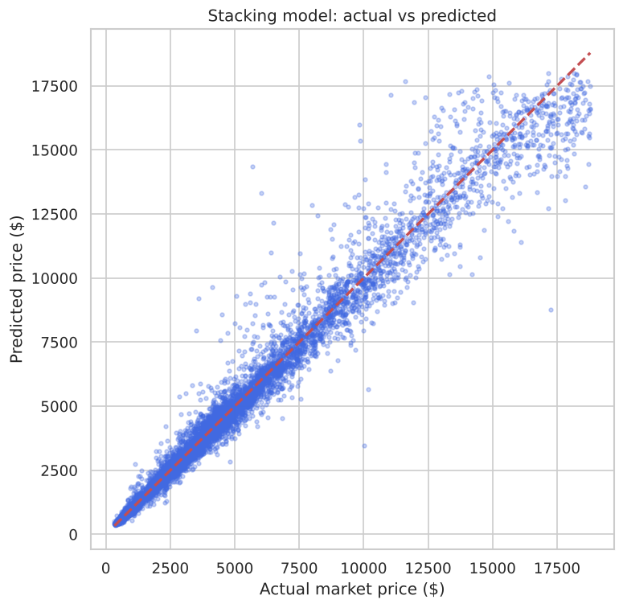
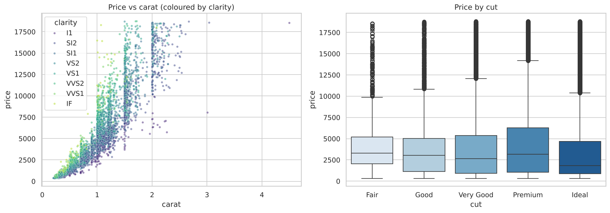
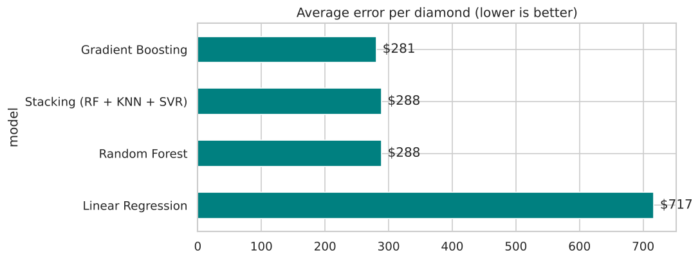

# 💎 Diamond Price Prediction — a Jeweler's Take on Machine Learning

Predicts diamond prices from the 4 Cs (carat, cut, color, clarity) and physical dimensions, using 53,940 diamonds.

I work in my family's gold and jewelry shop in Kadhimiya, Baghdad, so this project combines **domain expertise with data**: several cleaning decisions come from knowing what a real diamond can and cannot look like.



## Results (test set, 10,784 diamonds)

| Model | R² | MAE | MAPE |
|---|---|---|---|
| Linear Regression | 0.925 | $717 | 37.9% |
| Random Forest | 0.976 | $288 | 7.0% |
| **Stacking (Random Forest + KNN + SVR → Linear)** | **0.977** | **$288** | **7.0%** |
| **Gradient Boosting** | **0.982** | **$281** | 7.9% |

The ensembles explain ~98% of price variance with an average error under **$300 per stone**. Stacking and Gradient Boosting perform almost the same; Gradient Boosting is faster to train, so it's the practical choice to deploy.

## A jeweler's sanity check 🔍

While plotting the dimensions, some diamonds showed a **width of 58.9 mm** or a **depth of 31.8 mm**. A stone that size would weigh hundreds of carats — it doesn't exist on the market. Others had a dimension of **0 mm**.

Rather than "fix" them with guesses (like dividing by 10), I counted them first: **23 rows out of 53,940 (0.04%)**. Removing them costs nothing and keeps physically impossible stones out of training. No accuracy metric would have flagged this — it took knowing the product.

## EDA insights



* **Weight dominates**: price rises non-linearly with carat, with a sharp jump above ~1.5 ct.
* **The "Fair cut paradox"**: Fair-cut diamonds have a *higher* average price than Ideal ones — not because a poor cut is valuable, but because Fair stones in this dataset are much heavier. Weight hides the cut.
* **Clarity alone doesn't set the price**: big stones with poor clarity (I1, SI2) can still be very expensive. Every feature must be read together with carat.

## Approach

* `ColumnTransformer`: `StandardScaler` for numeric features, `OneHotEncoder` for cut / color / clarity.
* Compared Linear Regression, Random Forest and Gradient Boosting.
* **StackingRegressor**: Random Forest (trees), KNN (similar stones) and SVR (kernel) as base learners, with a Linear Regression meta-model learning how much to trust each.



## Next steps

* Predict `log(price)` to reduce percentage error on cheaper stones.
* Wrap the model in a small web app that jewelers can use to sanity-check a quote.

## Run it

```bash
pip install -r requirements.txt
jupyter notebook diamond_price_prediction.ipynb
```

**Data:** [Diamonds dataset (Kaggle)](https://www.kaggle.com/datasets/shivam2503/diamonds), `data/diamonds.csv`.

**Tech:** Python · pandas · scikit-learn (StackingRegressor, Pipeline) · seaborn · plotly

---

## 👤 Author

**Reda Akram** — Computer Science (AI) student at the University of Technology, Baghdad. I build ML models, automation systems and AI agents.

GitHub: [@devb777r](https://github.com/devb777r)
